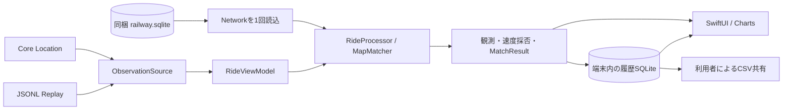

# RailVelo 技術設計 v0.4 — SwiftUI・走行記録

更新日: 2026-10-21。初期対象: JR九州・鹿児島本線の門司港〜博多。

本書はv0.3オフラインエンジンをiOSアプリへ接続する実装設計を記録する。ビルド・自動試験・Simulator・実機・実走の結果は [検証記録](VALIDATION.md) を正とし、設計の記述から実機合格を推定しない。Apple登録と導入は [Apple手順](APPLE_SETUP.md)、受入試験は [実機試験計画](DEVICE_TEST_PLAN.md) に分ける。

## 1. 継承する資産と責務

v0.3のSwift `MapMatcher`、`Network`、駅イベント判定、読み取り専用SQLiteローダーを再利用する。Pythonは参照実装・データ生成・比較に用い、iPhoneの推定実行へPythonランタイムを持ち込まない。元SQL、線形データ、出典・品質記録は `vendor/n02/` に維持する。v0.1/v0.2設計書本文の不足に関する前工程の制約は [v0.3設計](TECHNICAL_DESIGN_v0.3.md) を継承する。

| 層 | 実装・責務 |
| --- | --- |
| 入力 | `RailVeloLocation`。Core LocationまたはJSONLリプレイを共通の観測コールバックへ渡す |
| 推定 | `RailVeloCore`。状態を持つMapMatcher、線路候補、路線・方向・駅間・イベント |
| 線路読込 | `RailVeloSQLite`。アプリ同梱DBを読み取り専用でNetworkへ変換 |
| 記録 | `RailVeloRecording`。速度採否、走行状態、履歴DB、グラフ点の読出し、CSV |
| アプリ調停 | `RideViewModel`。入力の開始/停止、直列処理、保存、画面用状態、欠測監視 |
| 表示 | SwiftUI、Swift Charts。速度・精度・路線・駅間、グラフ、記録操作、履歴 |

同じMatcherと履歴DBを複数の入力から同時に更新しない。画面状態はMainActorで扱い、推定・書込は直列化する。起動・初期化でNetworkを読み込み、位置更新ごとに線路DB全体を再読込しない。新しい乗車は新しい推定状態を持つ。

## 2. OS・構成

Xcodeプロジェクトは `ios/RailVelo.xcodeproj`、共有schemeは`RailVelo`。iPhone縦画面、日本語UI、iOS 16.0以上、Swift 5言語モードを初期設定にする。Core Location、SwiftUI、Swift Charts、OSのSQLiteを使用する。アプリの新規外部ライブラリ依存はない。

最小対応OSは実行可能範囲の下限。配布ビルドにはAppleがアップロード時に求めるSDK・Xcodeを使用する。2026-04-28以降のApp Store Connect要件はiOS 26 SDK以降。[AppleのSDK要件](https://developer.apple.com/news/?id=ueeok6yw)

## 3. 観測・時刻・モード

観測のデータ契約は [CONTRACT.md](../CONTRACT.md)。時刻はUTC Unix秒、緯度経度はWGS84互換、距離はm、内部速度はm/s、方位は北0度・時計回り。画面速度と保存された有効速度はkm/hへ変換する。Core Locationの取得時刻を使い、コールバック到着時刻をGPS取得時刻へ置き換えない。

`ObservationSource`は開始・停止と観測/失敗コールバックを共通化する。実GPSは `CoreLocationSource`、リプレイは `ReplayObservationSource`。リプレイはfixtureの観測時刻を維持して仮想時計を進める。実GPSとリプレイの両方を同時に有効化しない。

`RideMode`は`live`/`replay`。セッション開始時に決め、セッション途中のモード変更を禁止する。記録・履歴・CSVにもモードを保存する。リプレイの履歴はテストデータと分かる表示にする。実GPSの権限確認はリプレイを妨げない。

付属アプリのリプレイは同梱`corridor_full.jsonl`の25倍速再生。全17シナリオはCLIと共通データ比較で検証し、アプリで別シナリオを表示する場合は試験用の同梱fixtureを差し替える。セッション開始/終了の操作時刻と、リプレイの元GPS観測時刻は異なるため、履歴一覧の操作時刻をグラフの時刻へ置き換えない。

## 4. 速度の採否と鮮度

速度表示はセンサーの有効な実測値に基づく。MapMatcherの予測位置から速度計の現在速度を生成しない。位置推定の状態と速度の有効性はそれぞれ保持する。

`RideProcessor`は次を検査し、採用しない場合に理由を残す。

| 検査 | 既定の扱い |
| --- | --- |
| 非有限・重複・逆行時刻 | 採用しない。時系列状態を壊さない |
| 緯度経度の欠損・範囲外 | 採用しない |
| 水平精度 | 有限、0より大きく150m以下を必要とする |
| 速度 | 有限、0〜60m/s（0〜216km/h）を必要とする |
| 速度精度 | 有限、0〜8m/sを必要とする |
| 座標跳躍・到達不能な遷移 | マッチャーが棄却した観測から速度を採用しない |
| 不自然な速度変化 | 時間差・両観測の速度精度を含む加速度の上限で除外 |
| 位置変化と速度の不一致 | 短い観測間隔では水平精度の余裕を含めて照合する |
| 古い/未来の取得時刻 | 実GPSの受信時刻より10秒超前、または5秒超未来なら除外し、現在値への採用を防ぐ |

有効速度だけが最高速度を更新する。無効値を0として最高速度・グラフに混ぜない。最高速度は同じセッションのpause/resumeで維持する。

実GPSの現在表示は、観測時刻から5秒以上経過すると速度・精度・現在の推定を失効させる。専用キューの処理結果も描画直前に時刻を再確認し、CSV出力などで遅れた古い結果が現在値を復活させないようにする。処理・保存の採否に使う受信時刻の10秒上限と、現在表示の5秒上限は別に扱う。

受信自体が5秒以上途絶えた場合には欠測観測を入力する。GPS受信が続いている処理待ちだけでは架空の欠測行を保存しない。最後の速度を現在の測定として表示し続けず、表示待機と受信断を分ける。リプレイは仮想時計を基準にし、実GPSのキャッシュ観測と意図した過去時刻を区別する。監視タイマーの実行もOSによる停止・終了の制約を受ける。

これらの上限は在来線用の暫定値。新幹線への適用や実走較正は次工程。センサー誤差と受信条件によって有効値を保留する場合がある。

## 5. 線路・駅間表示

推定のHMM・予測・駅イベント判定は [v0.3](TECHNICAL_DESIGN_v0.3.md) を継承する。確定路線・方面・前後駅はMatchResultとNetworkのID辞書から表示し、文字列を推定ロジックへ直書きしない。

| 状態 | 表示の意味 |
| --- | --- |
| `matched` | 実観測から確定条件を満たした推定 |
| `predicted` | 最後の確定観測に基づく短時間予測。実測と区別 |
| `uncertain` | 判定保留。確定路線や駅間として表示しない |
| `lost` | 位置不明。現在位置の確定を停止 |
| `rejected` | 不正・異常入力を棄却。理由を保持 |

次駅までの距離は代表経路上の累計距離差、進捗は当該駅間に対する0〜1。駅は「次に通る駅」と表示する。列車が次に停車する駅は時刻表・列車特定が必要なので断定しない。confidenceは候補内の相対支持度であり、正解確率としてパーセント精度を保証しない。

停車時も直近の確定区間・駅イベントを参照できるようにする。位置が古くなった場合は時刻や状態で過去の推定と分かるようにし、過去情報を現在の確定値として保持しない。駅イベントのarrival/departure/passはGPS上の推定で、扉開閉時刻や営業上の着発時刻とは区別する。

## 6. 履歴SQLite

線路DBはアプリ同梱・読み取り専用。走行履歴はアプリの保存領域に別DBを作る。ユーザーのGPS履歴を同梱DBへ混ぜたり、線路DBの更新で履歴を置換したりしない。

`RideStore`はOSのSQLiteを使用し、外部キー、WAL、`synchronous=FULL`、busy timeout、スキーマ版を設定する。1観測の保存・付随イベント・最高速度更新を1トランザクションにまとめ、失敗はロールバックする。保存に失敗した場合は利用者へ分かるエラーを出す。

| テーブル | 内容 |
| --- | --- |
| `sessions` | UUID、mode、開始/終了時刻、最終保存時刻`last_saved_at`、有効最高速度、状態、連続性の補助値 |
| `samples` | 取得時刻、元観測JSON、MatchResult JSON、採用速度、除外理由、グラフ区間ID |
| `events` | sampleに対応する駅イベント、推定時刻、駅ID、支持度 |
| `status_events` | 記録開始、一時停止、再開、終了、中断の状態と時刻 |

状態は`recording`→`paused`→`recording`→終了。同じセッションのpauseでは入力を止め、再開時はマッチャーの連続性と駅の停車時間判定を切る。pause前後を連続移動として補間しない。

再起動時、DBに残る記録中/一時停止中のセッションは`interrupted`にする。GPS/リプレイの観測時刻`last_timestamp`と、実際の保存時の壁時計`last_saved_at`を分離する。付属アプリは`append(_:to:recordedAt:)`へ保存時刻を渡す。復旧後の終了時刻は`max(開始時刻, 最終保存時刻)`とし、保存時刻がなければ開始時刻にする。リプレイの過去の観測時刻をセッション終了時刻へ流用して終了が開始より前になることを防ぐ。復旧操作の時刻は状態イベントに残す。既存DBに保存時刻列がない場合は追加する。停止中の未観測位置を補作しない。継続して乗車する場合は新しいセッションを開始する。

履歴はアプリ再起動後も読出し可能。終了したセッションを確認付きで削除し、関連sample/eventを外部キーで削除する。記録中/一時停止中の削除は禁止する。OS終了や電源断の直前に未確定だった入力まで保存されたとは保証しない。

## 7. グラフ・長時間動作

Swift Chartsの横軸は観測時刻、縦軸はkm/h。60秒、5分、セッション全体を切替える。速度無効・観測欠落・pauseを別segmentとして扱い、その間に連続線を引かない。

画面用配列は直近300秒・最大2400点に制限し、長時間分はDBへ保存する。全体表示と履歴はDB側の間引きで区間の端点・極値を優先し、最大1200点を要求する。高速度のピークや最後の観測が消えないこと、複数segmentが誤連結されないことを試験する。間引きしたグラフは全観測の完全表示ではなく、CSVには保存した元観測を出力する。

候補探索や経路キャッシュには既存の上限がある。長時間での端末CPU、メモリ、書込遅延、全体グラフの読込時間は実機試験で計測する。

## 8. CSVと個人情報

UTF-8、引用符エスケープ、CRLF区切りで出力し、一時ファイルを完成後に目的ファイルへ置換する。大きな履歴もSQLiteの行を順に読み、出力全体をメモリへ展開しない。

各観測行にはモード、UTCのISO 8601時刻、Unix秒、タイムゾーン、緯度経度、WGS84/EPSG:4326、水平精度、元速度m/s、速度精度m/s、方位、採用速度km/h、有効性、除外理由、推定状態・理由・路線・方向・前後駅・残距離・進捗・支持度・不確実性、元観測JSON、MatchResult JSONを含める。状態遷移は`session_status`行として区別する。行種別と時刻に従って読み取る。

GPS履歴は個人情報として端末内に保持する。アプリがGPSをサーバーへ自動送信する機能、広告・解析SDK、時刻表APIをこの工程では追加しない。履歴保存先はアプリのApplication Support内の`RailVelo/rides.sqlite`。ディレクトリに`completeUntilFirstUserAuthentication`とバックアップ除外を設定する。CSVも同じファイル保護を設定し、共有先は利用者が選ぶ。一時共有ファイルは次のエクスポート時に24時間超のものを削除し、履歴削除時は対応する一時CSVも削除する。保存設定・ロック中の書込・共有先の動作は実機で確認する。暗号鍵を扱う独自DB暗号化を実装したとは表現しない。

## 9. Core Locationと背景制約

位置取得は実GPSの記録中だけ有効化する。前面で許可を求めて開始し、pause・終了・リプレイでは停止する。拒否・制限・概算位置を画面で説明し、計測可能であるかのように表示しない。

iOSではBackground Modesの`location`と`allowsBackgroundLocationUpdates`を組み合わせる。背景表示インジケーターを有効にして利用者に動作を示す。When In Useで前面開始した位置更新は条件を満たすと背景で継続する。Always許可を要求していない状態をAlways取得済みと報告しない。[Appleの許可仕様](https://developer.apple.com/documentation/CoreLocation/requesting-authorization-to-use-location-services)、[背景更新設定](https://developer.apple.com/documentation/corelocation/cllocationmanager/allowsbackgroundlocationupdates)

OSはアプリの停止・終了や位置更新間隔を制御する。標準位置更新によるOS終了後の自動再開・無欠測継続は保証しない。画面ロック、別アプリ、低電力、トンネル、OS終了、手動強制終了を分けて受入確認する。高精度・自動pause無効は停車イベントに必要な観測を得るための初期設定で、電池への影響を実機で確認する。[標準位置更新の終了条件](https://developer.apple.com/documentation/CoreLocation/CLLocationManager/startUpdatingLocation%28%29?language=objc)

## 10. 拡張境界と検証

将来の列車特定・手動指定・種別・行先・停車駅・時刻表・遅延・到着予測は独立したサービスと表示データとして追加する。GPSのObservationやMapMatcherへ列車API呼出しを埋め込まない。列車ID・停車予定を保持する拡張では、地理的な次駅と営業上の次停車駅を別フィールドにする。現段階で未実装の操作を有効なボタンとして表示しない。

検証は次の順に分ける。

1. Python参照試験、データ整合性、既存17シナリオ評価。
2. Swiftのエンジン試験、記録・速度採否・SQLite再読込・中断復旧・CSV試験。
3. 全共有fixtureのPython/Swift結果比較。
4. Simulator/端末向け署名なしビルド、Simulatorリプレイ・ライト/ダーク表示。
5. 署名配布、iPhone導入、前面GPS、背景、実走、長時間性能・電池。

合成データの一致から現実の地図・受信・端末挙動が合格と推論しない。各結果を実行commitと結び付け、未実施・不合格は理由と再開手順を [作業記録](WORK_LOG.md) に残す。

[engine CI](https://github.com/KANABUNN/RailVelo/actions/runs/39447558500) はcommit `e206e23aacaaf9dcc298c54557808fda13ce40ba`で成功。Xcode 16.4 / iOS Simulator 18.5 SDKでPython36件、Core/SQLite12＋Recording17のSwift29件、17 fixture全件のPython/Swift比較、Core Location/SQLiteのiOS Simulator向けライブラリビルドに成功した。初期のNetwork/type guardのコンパイルとpkg-config経由のホストdylib参照の問題は修正済み。

[アプリCI](https://github.com/KANABUNN/RailVelo/actions/runs/39453148802) はcommit `8808fdd9f4bccf9122b7dceedfac99b60285a0eb`で成功。`macos-26` arm64、Xcode 26.6（17F113）/ iOS 26.5 SDK、iPhone 16 Simulator runtime 26.5で、Simulator/端末向け署名なしビルド、built Info.plist/同梱リソース、リプレイ5観測・有効速度5件・matched3件、中断復旧を確認した。ライト/ダークは実画像の背景3点の平均輝度（約0.9648 / 0.0）と目視で切替を確認した。画面に合成速度71.7 km/h、鹿児島本線・博多方面・駅間進捗を確認したが、画面下にあるグラフは今回の画像に含まれず、グラフ目視・UI全操作・VoiceOverは未検証である。

Swift/Python試験と17 fixture比較はengine CIが担当する。engineは`macos-15-intel`、アプリは`macos-26`を使い、関連pathとブランチ単位のconcurrencyで重複実行を抑える。利用者が許可した合成リプレイの診断artifactは1日保持し、実GPS・個人データは含めない。成功したrunと残る受入項目を検証記録に記録する。

App ID `jp.kb-dev.railvelo` とApp Store Connectアプリ「RailVelo」（ID `6824978233`）の登録完了は画面確認済み。内部グループ「本人検証」は自動配信オフ・テスター0人・ビルド0件・公開リンクなし。招待・証明書/APIキー生成・署名・アップロードは未実施。アプリのビルド成功と、Simulator動作・iPhone・実走の受入を区別する。
