# RailVelo 技術設計 v0.5 — 内部配布準備・実機受入

更新日: 2026-10-21。状態: **Simulator UI検証成功・本人限定配布のArchive失敗を調査中**。本書はv0.4の実装・検証を継承し、署名から本人用TestFlight、iPhone実機受入へ進む条件を記録する。Apple API認証・署名資料照合・keychain導入まで成功し、署名付きArchive・アップロード・本人グループへの追加・iPhone導入は未完了。

## 1. 継承するものと現在位置

GPS取得、RideProcessor/MapMatcher、履歴SQLite、CSV、SwiftUI/Charts、リプレイ、背景位置情報の構成は [v0.4](TECHNICAL_DESIGN_v0.4.md) を継承する。Python36件、Swift29件、17 fixture比較、署名なしアプリビルド、限定したSimulatorリプレイ・DB・復旧・ライト/ダークの実施結果は [検証記録](VALIDATION.md) を正とする。全国データ、列車特定・営業上の停車駅・時刻表・遅延はこの設計で追加しない。

| 対象 | 確認済みの状態 |
| --- | --- |
| Bundle ID | `jp.kb-dev.railvelo` |
| App Store Connect | RailVelo / `6824978233` |
| 内部グループ | 「本人検証」、自動配信オフ、テスター0人、ビルド0件、公開リンクなし |
| 署名資料 | 新しいDistribution証明書（2027-10-21まで）、自前秘密鍵との一致を確認したp12、RailVelo専用App Store Connectプロファイルを生成済み。既存アプリの秘密情報は流用していない |
| API/CI | 新しいDeveloper Teamキーを発行済み。Environment `railvelo-testflight`はmainのみ・tag 0件・本人required reviewer・admin bypass無効、7種類のSecrets名を確認済み |
| 署名/配布 | 利用者が新規発行・Secrets保管・本人限定uploadとグループ割当を承認済み。実API認証成功。Archive作成で停止し、upload・本人追加は未実施 |
| 実機 | iPhone 16 / iOS 27.0.1、TestFlight導入済み（本人申告）。RailVelo導入・GPS・背景・電池・実走は未検証 |

本人のApple Account、Team ID、APIキー識別情報、秘密鍵、端末UDID、実走位置を設計書へ転記しない。v0.1/v0.2設計書本文の未取得制約も継承する。

Distribution秘密鍵とp12はパスワードで暗号化している。APIのp8は平文の鍵形式で、署名資料とともに所有者/SYSTEMだけのACLで保管する。Secrets登録時の一時的なエージェント読取権限は利用者の明示許可後に追加し、登録後に削除したことを確認済み。保管先や秘密識別子は公開記録へ転記しない。

最終アプリ候補`afd55bb73ac919feed936a943899da115a6cd2b5`の[engine CI](https://github.com/KANABUNN/RailVelo/actions/runs/39531707938)はPython76件・Swift32件・interop・17 fixture比較に成功。[アプリCI](https://github.com/KANABUNN/RailVelo/actions/runs/39531634651)はSimulator/端末向け署名なしビルド・smoke/復旧・3件のUI試験に成功し、グラフ3期間・大きい文字・Darkの実画像も確認した。25秒間隔の合成fixtureによる点描画であり、連続線・実GPS・実際のVoiceOver読み上げは実機へ引き継ぐ。[検証記録](VALIDATION.md)

## 2. 推奨する署名・認証の分離

既存の他アプリ向け秘密情報を流用せず、新しいDistribution秘密鍵/CSR・証明書・p12とRailVelo専用App Store Connectプロファイルを利用者承認後に用意した。アップロード用の新しいDeveloper roleのTeam APIキーも発行済み。手動署名ではCIへProvisioning APIによる証明書・App ID・プロファイル自動作成を必須にしない。

必要な資料がない場合は新規発行を自動的に始めず、種類・用途・影響・保管先を利用者へ提示する。証明書はTeamの署名資格情報であり、p12自体がRailVeloに限定されるわけではない。プロファイルとworkflowは本アプリを対象とし、既存アプリ用の証明書を失効しない。[GitHubの署名資料導入](https://docs.github.com/en/actions/how-tos/deploy/deploy-to-third-party-platforms/sign-xcode-applications)、[Appleのプロファイル作成](https://developer.apple.com/help/account/provisioning-profiles/create-an-app-store-provisioning-profile)

APIはupload/internal TestFlightに必要なDeveloper roleを基本とする。今回のCI下書きはIssuer IDを持つTeamキーだけに対応し、**TeamキーはDeveloperでも全アプリが範囲となり、RailVeloだけへ制限できない**ことを承認時に明示する。Individual keyはユーザーの役割・アプリ範囲を継承するが、Account Holderなら本人の広い権限を継承する。Individual方式へ変更する場合は認証実装も見直し、キー名だけから権限を判断しない。[Appleの権限説明](https://developer.apple.com/videos/play/wwdc2026/8010/)

Individual keyはProvisioning APIを利用できない。自動署名/cloud signingを選択する場合は、キー種別に加えてCertificates, Identifiers & Profilesとcloud-managed Distributionの権限を確認する。新規証明書の自動作成が起こる場合も確認対象とし、Adminへの昇格を最初の解決策にしない。[キー制約](https://developer.apple.com/documentation/appstoreconnectapi/creating-api-keys-for-app-store-connect-api)、[cloud signing権限](https://developer.apple.com/documentation/appstoreconnectapi/userrole)

本人のMacが利用可能で、CIへの署名秘密登録を避けたい場合はXcode Organizer配布を代替とする。Windows中心の場合も編集・試験結果の確認はWindowsで行い、署名実行を承認したmacOS環境へ限定する。

## 3. 承認境界

利用者が秘密発行・Apple操作は説明と確認を要すると指定しているため、次を独立して確認する。

今回の新規発行、Environment/Secrets保管、本人限定アップロードと本人用グループ割当は利用者承認済み。承認範囲を他アプリの資格情報利用・外部テスター追加・App Store提出へ拡張しない。

1. 署名方式、既存資料の使用、新規発行する証明書/プロファイルの種類と対象。
2. APIの役割・アプリ範囲と、GitHub Environmentへ保存する秘密の種類。
3. 固定したcommit・version/buildでの内部限定署名付きアップロード。
4. 本人用グループへ本人テスターを追加し、buildを割り当てる操作。招待メールの発生可能性も説明する。

確認前は資格情報の値を開かず、メタデータ・有効期限・用途の確認、文書・workflow案作成まで進める。秘密情報をチャットへ貼り付けるよう依頼しない。契約同意と認証は本人が行う。既存資料の利用許可を他アプリのキー共用や失効許可へ拡張しない。

## 4. 配布パイプライン案

```mermaid
flowchart LR
    Commit[検証済みcommit] --> Verify[署名なし試験結果と差分確認]
    Verify --> Approval[利用者確認と配布Environment]
    Approval --> Sign[一時keychainで署名Archive]
    Sign --> Inspect[Archiveの署名・識別子・プロファイル検査]
    Inspect --> Upload[内部限定exportで直接upload]
    Upload --> Process[Apple処理 VALID]
    Process --> Group[本人検証 group と本人 tester]
    Group --> Phone[iPhoneへ導入して版を照合]
    Phone --> Acceptance[実機・実走受入]
```

通常のPR/Simulator CIへ署名Secretsを渡さない。[配布workflow下書き](../.github/workflows/testflight.yml)は手動起動だけを受け付け、公式リポジトリのmainからのみ実行する。40桁の対象SHAがmainの祖先で、同じSHAの`swift.yml`と`ios.yml`が両方成功したことをGitHub APIで確認する。`GITHUB_TOKEN`は`contents: read`と`actions: read`だけにする。署名用Environment `railvelo-testflight`はmain限定・本人required reviewer・admin bypass無効とし、7種類のSecrets登録を確認済み。[GitHub Environment保護](https://docs.github.com/en/actions/how-tos/deploy/configure-and-manage-deployments/manage-environments)

runner上の鍵・p12・profileは権限制限した一時領域と一時keychainに保存し、元のkeychain検索設定と既存profileを退避・復元する。Apple側の新規発行APIを呼ばず、Team/Bundle、App Store用属性、有効期限、p12との証明書一致を送信前に検査する。証明書名・Team ID・profile UUIDをmaskし、コマンドの生出力は非公開の一時ファイルだけへ保存する。公開artifactは許可した項目だけのstatus JSONを1日間保存し、IPA・Archive・profile・生ログを含めない。

Archiveを検査後、`method=app-store-connect`、`destination=upload`、`signingStyle=manual`、`testFlightInternalTestingOnly=true`でXcodeから直接送信する。実行に使うXcode 26.6の`xcodebuild -help`に必要キー・型とmethodが存在しなければ停止する。Xcode 26.6でCLIの対応確認は成功した。署名付きArchiveの作成は失敗しており、送信は未実施。送信後は読み取りAPIで`VALID`かつ`buildAudienceType=INTERNAL_ONLY`まで確認し、20分以内に確認できなければ失敗として記録する。本人のテスター追加・割当は自動化しない。[Appleの配布設定](https://developer.apple.com/documentation/xcode/distributing-your-app-for-beta-testing-and-releases)、[CLI設定確認](https://developer.apple.com/library/archive/technotes/tn2339/_index.html)、[内部限定属性](https://developer.apple.com/documentation/appstoreconnectapi/buildaudiencetype)

補助コードのオフライン境界試験34件が成功した。対象SHA/試験照合、profile/署名属性、内部限定API応答、ログ非出力、後処理復元、復元snapshotの原子的更新を合成データで確認した結果であり、単独では実署名・送信の成功を意味しない。実材料の解析・API認証は配布runで別に成功を確認した。ASC readbackでは関連アプリを明示取得し、ID・Bundle ID・一意性を照合する。失敗時は固定分類と整数の終了コードだけを公開し、生ログから秘密・名前・pathを転記しない試験も含む。Python依存はES256とp12/証明書解析に必要な`PyJWT[crypto]==2.15.1`、`cryptography==50.0.2`に固定した。2026-10-21時点の安定版を公式変更履歴で確認し、arm64 runnerを使用する。[PyJWT変更履歴](https://pyjwt.readthedocs.io/en/stable/changelog.html)、[cryptography変更履歴](https://cryptography.io/en/latest/changelog/)

## 5. version/buildと監査記録

現プロジェクト設定は`0.5.0 (500.0.1)`。配布workflowはversionを`0.5.0`、buildを`500.<GITHUB_RUN_NUMBER>.<GITHUB_RUN_ATTEMPT>`へ上書きする。例は`500.12.3`。再実行で変わらないrun番号に、増加するattemptを組み合わせる。送信前には同じASCアプリ・version・buildが存在しないことを読み取りで確認し、衝突時は送信しない。workflowの移行や手動配布で採番規則が変わる場合は、既存最大値とAppleの受理を改めて確認する。[Apple build string](https://developer.apple.com/help/glossary/build-string/)、[GitHub run変数](https://docs.github.com/en/actions/reference/workflows-and-actions/variables)

監査記録に残すのは対象commit、version/build、Xcode/SDK、Bundle ID、署名検査の成否、run URL、Appleの処理状態、内部限定・グループ・テスター数、iPhone導入確認の有無。署名付き成果物の検査ではTeam/Bundle IDとprofileを内部で照合しても、個人の資格情報を公開報告へ転記しない。

## 6. TestFlightの完了条件

| 段階 | 必要な証跡 |
| --- | --- |
| アップロード | 対象アプリ・version/buildに一致する転送成功 |
| Apple処理 | `processingState=VALID`。失敗/未処理/期限切れを利用可能と扱わない |
| 内部限定 | Internal Onlyの表示または対応API属性を確認 |
| テスト割当 | 「本人検証」の対象buildと本人テスターのみ。公開リンクなし、自動配信オフを維持 |
| 端末 | 本人がTestFlightから導入し、版と起動を照合 |
| 実機受入 | 実GPS・背景・欠測・履歴・CSV・電池・実走を別記録で確認 |

処理完了、グループ作成、本人への割当、iPhone導入は別の状態である。招待やテスター追加は確認後に行う。`VALID`だけでは実機動作確認済みにならない。[build処理状態](https://developer.apple.com/documentation/appstoreconnectapi/build/attributes-data.dictionary)、[内部テスター](https://developer.apple.com/help/app-store-connect/test-a-beta-version/add-internal-testers)

## 7. 実機への引継ぎ

[実機試験計画](DEVICE_TEST_PLAN.md)でまず配布buildを照合し、同梱リプレイ、前面GPS、許可拒否/概算位置、5秒の表示失効、保存・CSVを確認する。続いてロック/別アプリ、終了復旧、電池・長時間を試験し、門司港〜博多の実走へ進む。グラフ目視・UI全操作・VoiceOverはv0.4から残る受入項目として確認する。

実走CSV・画面・端末ログは個人用の非公開管理とし、公開の成果物には条件と集計結果を記録する。実測結果とSimulatorの合成結果を混ぜず、試験失敗を再現fixtureへ縮約して改善する。署名方式とSecrets準備は完了したが、実署名・認証・アップロード・テスター割当・iPhone導入は未完了。

## 8. 実走診断と解析

v0.5の診断は、v0.4のGPS・推定・履歴保存を継承し、実走時の原因調査と後からの正解照合に必要な情報を加える。測位精度や端末性能の改善を実測済みとする変更ではない。個々のcommitで成功した試験と未検証範囲は[検証記録](VALIDATION.md)を正とする。

### 時刻・SQLite・CSV

`samples`へnullableな`received_at`と`persistence_started_at`を追加する。既存のschema version 1を列の有無で確認し、ない列だけを追加する。旧観測のJSON・速度・推定結果・順序を維持し、旧行に受信時刻を推測して埋めない。受信/保存処理開始時刻がない旧行はnullのまま残す。

| 時計 | 意味・制約 |
| --- | --- |
| Observationのtimestamp | 元GPSの取得時刻。リプレイはfixtureの時計を維持する |
| `received_at` | アプリが入力を受け取った壁時計の時刻 |
| `persistence_started_at` | 推定後、保存処理へ渡す直前に取得した壁時計の時刻。SQL実行・commit完了の時刻ではない |
| `sessions.last_saved_at` | セッションに最後に渡した保存処理開始側の壁時計。既存の中断復旧に使う補助値で、個別commit完了を証明しない |

`diagnostics`はセッションへ外部キーで関連付け、セッション削除時は`ON DELETE CASCADE`で削除する。診断の時刻とJSON payloadを保存し、payloadには`kind`と任意の`domain`、整数`code`、`detail`を持つ。detailは最大2000文字へ制限する。診断はCPU・メモリ・電池の自動計測ではない。OSのエラー文やアプリ状態を含み得るため、元の診断本文も個人用の履歴として扱う。

CSVは先頭36列の名前と順序を維持し、末尾へ`received_unix_seconds`、`persistence_started_unix_seconds`、`details_json`の3列を追加して39列にする。元の観測時刻・WGS84・単位・有効性・除外理由・MatchResultを維持する。行種別で用途を区別し、診断や要約の空欄をGPS観測として数えない。

| `record_type` | 内容 |
| --- | --- |
| `observation` | 元観測と推定結果。新しい時刻列は記録がある場合だけ出力 |
| `session_status` | 開始・一時停止・再開・終了・中断の状態遷移 |
| `diagnostic` | `details_json`にkind/domain/code/detailを持つ診断 |
| `session_summary` | `details_json`にstarted_at/ended_at/last_saved_at/maximum_speed_kmh/statusと時刻の意味を持つセッション要約 |

受信から保存処理開始までの差には、処理待ちと推定等が含まれる。これをCPU時間、単独のキュー待機時間、SQLite書込時間やcommit時間へ読み替えない。要約の`timing_semantics`は`received_to_persistence_start_excludes_sql_and_commit`でこの境界を明示する。

### 入力・状態・失敗の記録

RideViewModelはMainActorで入力コールバックと画面状態を扱い、既存の専用直列workerへ推定・保存・履歴操作を投入する。受信時刻を入力の受取側で確保し、保存処理開始時刻をworker内で確保する。入力が処理待ちになっても元の観測時刻を変更しない。

Core Locationのエラーはdomain/code/detailを診断へ渡す。位置許可・正確な位置情報の状態、開始時のコンテキスト、scenePhaseのactive/inactive/background、保存失敗、リプレイ入力の失敗を該当セッションの診断として記録する。scenePhaseは画面状態の情報であり、OSが実際にアプリを終了した原因やその時刻を観測できる仕組みではない。

診断保存はbest effortとする。ストレージ不足やDB利用不能では診断自身も保存に失敗し得るため、診断保存の失敗から再び診断や保存エラー処理を呼ぶ再帰を作らない。診断の書込完了を確認できない場合に保存済みと表示しない。通常の履歴保存失敗では入力を止め、利用者へ停止を示す。

実GPSの速度・現在区間は表示側でも観測時刻から5秒で失効させる。受信が続いていてもworkerが滞留した場合は現在値をクリアし、古いcompletionによる現在表示の上書きを防ぐ。受信断による欠測行と、処理待ちによる表示失効を区別し、処理待ちだけを理由に架空の欠測観測を増やさない。元時刻で受信した有効な履歴・最高速度の保存は維持する。リプレイはこの壁時計の表示期限へ混ぜない。

### 非公開の事後解析

解析は`scripts/analyze_ride.py`、利用方法は[実走解析ガイド](RIDE_EVALUATION.md)、手動記録の雛形は`docs/templates/`に置く。36列の旧CSVと39列の拡張CSVを読み、元ファイルと線路DBを変更せず、明示したローカル出力先へJSON/Markdownを作る。入力・正解・測定のSHA-256と線路データの識別情報を残し、複数セッションやlive/replayが混在した入力を拒否する。

路線・方向・前後駅の正解率は、手動の正解記録でその項目が分かる参照だけを分母にする。許容時刻差内の観測なし、判定保留、必要項目なしはunknownとして正解に含めない。確定時正解率、対象全体での正解割合、coverageを併記する。距離は同じ路線のedge/offsetを線路上の累計距離へ変換でき、正解の距離がある場合だけ比較する。predictedの距離誤差はmatchedと分ける。

GPS生座標から確定edgeやスナップ点への距離は幾何的な残差であり、独立した正解がないときに測位誤差・実走精度とは呼ばない。N02の駅位置から作る参照表も同じ地図の基準値であり、独立した現地測量の正解ではない。

駅イベントは種類・分かる駅/路線/方向・時刻で一対一照合する。手動記録が不完全な区間の未注記予測を誤検出として採点せず、適合率には完全記録を宣言した範囲を必要とする。欠測復帰は正解の路線と復旧時刻がある場合に評価し、探索時間を最後まで観測できないケースは打切りとして分離する。正解不足を成功へ読み替えない。

CPU・resident memory・電池は別の測定記録を利用者が供給した場合だけ集計し、未測定項目はnullにする。リプレイ元時刻と壁時計を引き算して実GPSの受信遅延と見なさず、保存経路の経過と端末性能を区別する。人工CSVの自動試験・Swift生成の人工CSVをPythonで読む相互運用試験は、解析処理の検証であり実走性能の評価ではない。

実走CSV・正解・測定・解析結果はGit除外対象の`recordings/`以下など本人の非公開領域へ置く。実走ファイルを自動的にCIへ送らず、公開成果物やissueへ添付しない。CIで保持するCSVは明示した人工リプレイだけとし、実GPS・Apple資格情報・自由記述の診断本文を公開の試験データへ流用しない。

## 9. Simulator UI受入

ソースのアプリversionは`0.5.0`とし、画面のversion/buildはBundleの値を表示する。署名workflowによるbuild番号上書きと、Simulator/実機に導入した版を区別して確認する。

`ios/RailVeloUITests/`は配布対象と同じアプリ、ObservationSource、MapMatcher、RideStoreを使って操作する。画面だけの代替ViewModelや固定値へ置き換えず、同梱の合成GPSリプレイを入力とする。実GPS許可、Appleアカウント、外部APIを試験の前提にしない。アプリの初期化完了と状態遷移には実際のボタン状態・値を待ち、固定sleepの経過を機能成功と扱わない。

`ready`と`transitioning`をPublishedの読取状態として画面へ伝える。記録操作は初期化中と、開始・一時停止・再開・終了をDBへ反映している間に無効化し、UIとメソッド側のguardで二重操作を防ぐ。専用workerの直列順序を操作のbarrierとし、未保存の状態へ先に再開する操作を通さない。再開後のグラフは新しいsegmentへ分け、処理待ちだった休止前の観測があっても休止区間を連続線で結ばない。

| 受入経路 | 試験の確認対象 |
| --- | --- |
| 開始と速度 | 実際の初期化後にリプレイを選択して開始し、有効な観測速度が速度計へ届くこと |
| 60秒/5分/全体 | 各範囲を操作し、選択状態と観測件数を確認。Chart領域のスクリーンショット内のデータ色pixelも確認し、コンテナの存在だけを描画成功にしない |
| 記録操作 | 一時停止・再開・終了の状態遷移と、永続化完了後の操作可否 |
| 履歴と削除 | paused履歴の表示と削除不可、完了した対象の確認付き削除、他セッションを残すこと |
| CSV共有 | 実際の保存済み履歴からネイティブ共有sheetを開き、送信せず閉じること |
| 外観・大きな文字 | ライト/ダークの実際のSimulator外観、主要操作の到達可能性、大きな文字での表示とスクロール |
| アクセシビリティ | 識別子・ラベル・値、hit region、説明、文字の欠け、Dynamic Type等の指定した監査項目 |

グラフpixel検査はデータの描画有無を補う確認で、速度値や各点の物理的正確さを認定するものではない。値・時間軸・欠測区間・間引きの計算は記録/解析の試験と合わせて確認する。CSVの列・引用符・診断・要約・旧DB移行はRideStoreとPython解析の試験で確認し、共有sheetを閉じた試験をFilesへの保存・メール送信・共有先の動作確認へ読み替えない。

アクセシビリティの自動監査は指定した項目を対象とし、実際のVoiceOverによる読み上げ、スワイプ順、音声操作、全環境の見え方を確認したとは扱わない。実機のVoiceOver、GPS許可、画面ロック・背景、ストレージ制約、長時間のCPU/メモリ/電池、実走は引き続き[実機試験計画](DEVICE_TEST_PLAN.md)で受け入れる。

UI試験のコード・workflow・画面証跡の存在と、実際に成功した試験結果を区別する。対象SHA、runner/Xcode/SDK、成功/不合格、再試験の結果は[検証記録](VALIDATION.md)を正とし、Simulatorの人工リプレイを実機GPS・実走の評価へ含めない。
