# RailVelo 技術設計 v0.5 — 内部配布準備・実機受入

更新日: 2026-10-21。状態: **本人限定配布の利用者承認済み・署名資料とSecrets準備済み**。本書はv0.4の実装・検証を継承し、署名から本人用TestFlight、iPhone実機受入へ進む条件を記録する。実署名・API認証・アップロード・本人グループへの追加・iPhone導入は未実施。

## 1. 継承するものと現在位置

GPS取得、RideProcessor/MapMatcher、履歴SQLite、CSV、SwiftUI/Charts、リプレイ、背景位置情報の構成は [v0.4](TECHNICAL_DESIGN_v0.4.md) を継承する。Python36件、Swift29件、17 fixture比較、署名なしアプリビルド、限定したSimulatorリプレイ・DB・復旧・ライト/ダークの実施結果は [検証記録](VALIDATION.md) を正とする。全国データ、列車特定・営業上の停車駅・時刻表・遅延はこの設計で追加しない。

| 対象 | 確認済みの状態 |
| --- | --- |
| Bundle ID | `jp.kb-dev.railvelo` |
| App Store Connect | RailVelo / `6824978233` |
| 内部グループ | 「本人検証」、自動配信オフ、テスター0人、ビルド0件、公開リンクなし |
| 署名資料 | 新しいDistribution証明書（2027-10-21まで）、自前秘密鍵との一致を確認したp12、RailVelo専用App Store Connectプロファイルを生成済み。既存アプリの秘密情報は流用していない |
| API/CI | 新しいDeveloper Teamキーを発行済み。Environment `railvelo-testflight`はmainのみ・tag 0件・本人required reviewer・admin bypass無効、7種類のSecrets名を確認済み |
| 署名/配布 | 利用者が新規発行・Secrets保管・本人限定uploadとグループ割当を承認済み。実署名・認証・upload・本人追加は未実施 |
| 実機 | 導入・GPS・背景・電池・実走は未検証 |

本人のApple Account、Team ID、APIキー識別情報、秘密鍵、端末UDID、実走位置を設計書へ転記しない。v0.1/v0.2設計書本文の未取得制約も継承する。

ローカル秘密鍵は暗号化し、所有者/SYSTEMに限定したACLで保管している。Secrets登録時の一時的なエージェント読取権限は利用者の明示許可後に追加し、登録後に削除したことを確認済み。保管先や秘密識別子は公開記録へ転記しない。

最新のsource `083e`では[engine CI](https://github.com/KANABUNN/RailVelo/actions/runs/39524933942)がPython52件・Swift32件・interop・17 fixture比較に成功。アプリCIはSimulator/端末向け署名なしビルドとsmokeが成功したが、復旧試験はfixtureの自然終了によって前提を満たさず失敗した。試験前提を修正済みで、次commitで再実行予定。v0.4の復旧成功を新しいsource全体の合格へ読み替えない。

## 2. 推奨する署名・認証の分離

既存の他アプリ向け秘密情報を流用せず、新しいDistribution秘密鍵/CSR・証明書・p12とRailVelo専用App Store Connectプロファイルを利用者承認後に用意した。アップロード用の新しいDeveloper roleのTeam APIキーも発行済み。手動署名ではCIへProvisioning APIによる証明書・App ID・プロファイル自動作成を必須にしない。

必要な資料がない場合は新規発行を自動的に始めず、種類・用途・影響・保管先を利用者へ提示する。証明書はTeamの署名資格情報であり、p12自体がRailVeloに限定されるわけではない。プロファイルとworkflowは本アプリを対象とし、既存アプリ用の証明書を失効しない。[GitHubの署名資料導入](https://docs.github.com/en/actions/how-tos/deploy/deploy-to-third-party-platforms/sign-xcode-applications)、[Appleのプロファイル作成](https://developer.apple.com/help/account/provisioning-profiles/create-an-app-store-provisioning-profile)

APIはupload/internal TestFlightに必要なDeveloper roleを基本とする。今回のCI下書きはIssuer IDを持つTeamキーだけに対応し、**TeamキーはDeveloperでも全アプリが範囲となり、RailVeloだけへ制限できない**ことを承認時に明示する。Individual keyはユーザーの役割・アプリ範囲を継承するが、Account Holderなら本人の広い権限を継承する。Individual方式へ変更する場合は認証実装も見直し、キー名だけから権限を判断しない。[Appleの権限説明](https://developer.apple.com/videos/play/wwdc2026/8010/)

Individual keyはProvisioning APIを利用できない。自動署名/cloud signingを選択する場合は、キー種別に加えてCertificates, Identifiers & Profilesとcloud-managed Distributionの権限を確認する。新規証明書の自動作成が起こる場合も確認対象とし、Adminへの昇格を最初の解決策にしない。[キー制約](https://developer.apple.com/documentation/appstoreconnectapi/creating-api-keys-for-app-store-connect-api)、[cloud signing権限](https://developer.apple.com/documentation/appstoreconnectapi/userrole)

本人のMacが利用可能で、CIへの署名秘密登録を避けたい場合はXcode Organizer配布を代替とする。Windows中心の場合も編集・試験結果の確認はWindowsで行い、署名実行を承認したmacOS環境へ限定する。

## 3. 承認境界

利用者が秘密発行・Apple操作は説明と確認を要すると指定しているため、次を独立して確認する。

今回の新規発行、Environment/Secrets保管、本人限定アップロードと本人用グループ割当は利用者承認済み。承認範囲を他アプリの資格情報利用・外部テスター追加・App Store提出へ拡張しない。

1. 署名方式、既存資料の使用、新規発行する証明書/プロファイルの種類と対象。
2. APIの役割・アプリ範囲と、GitHub Environmentへ保存する秘密の種類。
3. 固定したcommit・version/buildでの内部限定署名付きアップロード。
4. 本人用グループへ本人テスターを追加し、buildを割り当てる操作。招待メールの発生可能性も説明する。

確認前は資格情報の値を開かず、メタデータ・有効期限・用途の確認、文書・workflow案作成まで進める。秘密情報をチャットへ貼り付けるよう依頼しない。契約同意と認証は本人が行う。既存資料の利用許可を他アプリのキー共用や失効許可へ拡張しない。

## 4. 配布パイプライン案

```mermaid
flowchart LR
    Commit[検証済みcommit] --> Verify[署名なし試験結果と差分確認]
    Verify --> Approval[利用者確認と配布Environment]
    Approval --> Sign[一時keychainで署名Archive]
    Sign --> Inspect[Archiveの署名・識別子・プロファイル検査]
    Inspect --> Upload[内部限定exportで直接upload]
    Upload --> Process[Apple処理 VALID]
    Process --> Group[本人検証 group と本人 tester]
    Group --> Phone[iPhoneへ導入して版を照合]
    Phone --> Acceptance[実機・実走受入]
```

通常のPR/Simulator CIへ署名Secretsを渡さない。[配布workflow下書き](../.github/workflows/testflight.yml)は手動起動だけを受け付け、公式リポジトリのmainからのみ実行する。40桁の対象SHAがmainの祖先で、同じSHAの`swift.yml`と`ios.yml`が両方成功したことをGitHub APIで確認する。`GITHUB_TOKEN`は`contents: read`と`actions: read`だけにする。署名用Environment `railvelo-testflight`はmain限定・本人required reviewer・admin bypass無効とし、7種類のSecrets登録を確認済み。[GitHub Environment保護](https://docs.github.com/en/actions/how-tos/deploy/configure-and-manage-deployments/manage-environments)

runner上の鍵・p12・profileは権限制限した一時領域と一時keychainに保存し、元のkeychain検索設定と既存profileを退避・復元する。Apple側の新規発行APIを呼ばず、Team/Bundle、App Store用属性、有効期限、p12との証明書一致を送信前に検査する。証明書名・Team ID・profile UUIDをmaskし、コマンドの生出力は非公開の一時ファイルだけへ保存する。公開artifactは許可した項目だけのstatus JSONを1日間保存し、IPA・Archive・profile・生ログを含めない。

Archiveを検査後、`method=app-store-connect`、`destination=upload`、`signingStyle=manual`、`testFlightInternalTestingOnly=true`でXcodeから直接送信する。実行に使うXcode 26.6の`xcodebuild -help`に必要キー・型とmethodが存在しなければ停止する。このCLI確認と署名付き実行は未検証。送信後は読み取りAPIで`VALID`かつ`buildAudienceType=INTERNAL_ONLY`まで確認し、20分以内に確認できなければ失敗として記録する。本人のテスター追加・割当は自動化しない。[Appleの配布設定](https://developer.apple.com/documentation/xcode/distributing-your-app-for-beta-testing-and-releases)、[CLI設定確認](https://developer.apple.com/library/archive/technotes/tn2339/_index.html)、[内部限定属性](https://developer.apple.com/documentation/appstoreconnectapi/buildaudiencetype)

補助コードのオフライン境界試験22件が成功した。対象SHA/試験照合、profile/署名属性、内部限定API応答、ログ非出力、後処理復元、復元snapshotの原子的更新を合成データで確認した結果であり、実際のp12解析・署名・API認証・送信の成功を意味しない。失敗時は固定分類と整数の終了コードだけを公開し、生ログから秘密・名前・pathを転記しない試験も含む。Python依存はES256とp12/証明書解析に必要な`PyJWT[crypto]==2.15.1`、`cryptography==50.0.2`に固定した。2026-10-21時点の安定版を公式変更履歴で確認し、arm64 runnerを使用する。[PyJWT変更履歴](https://pyjwt.readthedocs.io/en/stable/changelog.html)、[cryptography変更履歴](https://cryptography.io/en/latest/changelog/)

## 5. version/buildと監査記録

現プロジェクト設定は`0.5.0 (500.0.1)`。配布workflowはversionを`0.5.0`、buildを`500.<GITHUB_RUN_NUMBER>.<GITHUB_RUN_ATTEMPT>`へ上書きする。例は`500.12.3`。再実行で変わらないrun番号に、増加するattemptを組み合わせる。送信前には同じASCアプリ・version・buildが存在しないことを読み取りで確認し、衝突時は送信しない。workflowの移行や手動配布で採番規則が変わる場合は、既存最大値とAppleの受理を改めて確認する。[Apple build string](https://developer.apple.com/help/glossary/build-string/)、[GitHub run変数](https://docs.github.com/en/actions/reference/workflows-and-actions/variables)

監査記録に残すのは対象commit、version/build、Xcode/SDK、Bundle ID、署名検査の成否、run URL、Appleの処理状態、内部限定・グループ・テスター数、iPhone導入確認の有無。署名付き成果物の検査ではTeam/Bundle IDとprofileを内部で照合しても、個人の資格情報を公開報告へ転記しない。

## 6. TestFlightの完了条件

| 段階 | 必要な証跡 |
| --- | --- |
| アップロード | 対象アプリ・version/buildに一致する転送成功 |
| Apple処理 | `processingState=VALID`。失敗/未処理/期限切れを利用可能と扱わない |
| 内部限定 | Internal Onlyの表示または対応API属性を確認 |
| テスト割当 | 「本人検証」の対象buildと本人テスターのみ。公開リンクなし、自動配信オフを維持 |
| 端末 | 本人がTestFlightから導入し、版と起動を照合 |
| 実機受入 | 実GPS・背景・欠測・履歴・CSV・電池・実走を別記録で確認 |

処理完了、グループ作成、本人への割当、iPhone導入は別の状態である。招待やテスター追加は確認後に行う。`VALID`だけでは実機動作確認済みにならない。[build処理状態](https://developer.apple.com/documentation/appstoreconnectapi/build/attributes-data.dictionary)、[内部テスター](https://developer.apple.com/help/app-store-connect/test-a-beta-version/add-internal-testers)

## 7. 実機への引継ぎ

[実機試験計画](DEVICE_TEST_PLAN.md)でまず配布buildを照合し、同梱リプレイ、前面GPS、許可拒否/概算位置、5秒の表示失効、保存・CSVを確認する。続いてロック/別アプリ、終了復旧、電池・長時間を試験し、門司港〜博多の実走へ進む。グラフ目視・UI全操作・VoiceOverはv0.4から残る受入項目として確認する。

実走CSV・画面・端末ログは個人用の非公開管理とし、公開の成果物には条件と集計結果を記録する。実測結果とSimulatorの合成結果を混ぜず、試験失敗を再現fixtureへ縮約して改善する。署名方式とSecrets準備は完了したが、実署名・認証・アップロード・テスター割当・iPhone導入は未完了。
